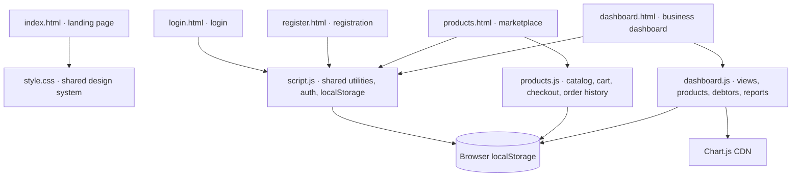

# Project overview and architecture

## Overview

The project presents **Smart Traders**, a marketplace and lightweight business-management interface for small traders. Its pages cover a public landing page, account registration and login, a product marketplace, and a business dashboard. The interface copy and currency formatting target Kenyan traders (KES).

## Architecture observed in source

This is a source-level description, not a deployed-system diagram. The shared `script.js` defines the theme, toast messages, data-store helpers, utilities, and authentication helpers. Page-specific scripts provide marketplace and dashboard behavior. The application stores businesses, buyers, sessions, products, orders, debtors, and notifications in browser storage. The dashboard references Chart.js from a CDN; the stylesheet imports Google Fonts.

No server/API layer, database service, build system, package manifest, or deployment setup was present in the inspected project root. Therefore, the observed architecture is client-side and single-browser: it does not provide demonstrated cross-device synchronization or server-backed authentication.

## Project entry points

| Page | Role |
| --- | --- |
| `index.html` | Marketing landing page and navigation |
| `register.html` | Business and buyer registration forms |
| `login.html` | Business and buyer login forms |
| `products.html` | Marketplace, cart, checkout UI, and buyer order history |
| `dashboard.html` | Business overview and management views |

Supporting code: `style.css`, `script.js`, `products.js`, and `dashboard.js`.
